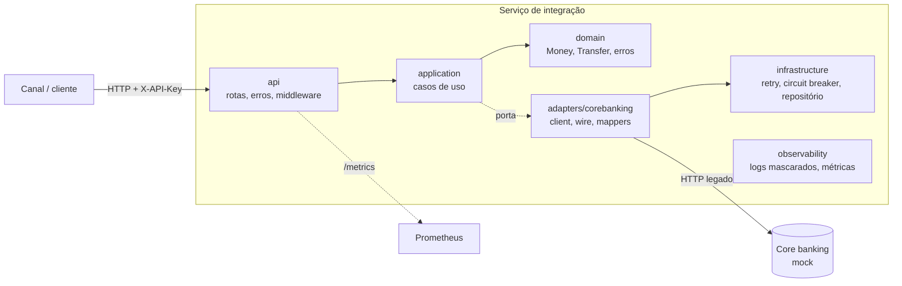
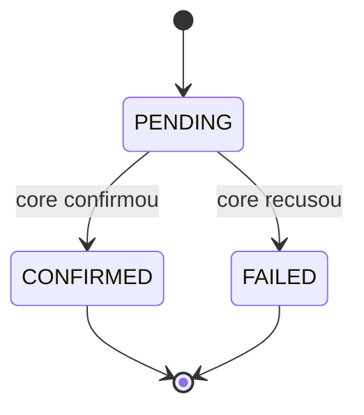

# Arquitetura

Este documento explica **o que** foi construído e, principalmente, **por que** cada peça existe.
Os detalhes de cada decisão estão nos ADRs em [`docs/adr/`](adr/README.md).

## 1. O problema

Um *core banking* é o **sistema de registro** do banco: contas, saldos, lançamentos. Ele é
antigo, lento, formato estranho (códigos em maiúsculas, datas `YYYYMMDD`, status de uma letra)
e **errar custa dinheiro**. O nosso serviço fica na frente dele e precisa:

1. Traduzir o mundo estranho do core para uma API limpa (anti-corruption layer).
2. Nunca mover dinheiro duas vezes (idempotência).
3. Sobreviver quando o core falha ou demora (timeout, retry, circuit breaker).
4. Admitir quando **não sabe** o que aconteceu, e descobrir depois (reconciliação).

## 2. Visão geral

A regra de dependência é: **setas apontam para dentro**. `domain` não conhece ninguém.
`application` conhece só o `domain` e as *portas* (interfaces). Quem implementa as portas
(`adapters`, `infrastructure`) fica na borda. Isso é a *arquitetura hexagonal* (ADR 0001).

## 3. Mapa do código

| Pasta | Responsabilidade | Conhece HTTP? | Conhece o formato do core? |
|---|---|---|---|
| `src/core_integration/domain` | Modelo do negócio: `Money`, `Transfer` (máquina de estados), erros | não | não |
| `src/core_integration/application` | Casos de uso: saldo, extrato, transferência, reconciliação; define as portas | não | não |
| `src/core_integration/adapters/corebanking` | Fala com o core: `client`, validação do `wire`, `mappers` | só do core | **sim (só aqui)** |
| `src/core_integration/infrastructure` | Retry, circuit breaker, repositório em memória, settings | não | não |
| `src/core_integration/observability` | Logs JSON com máscara, métricas Prometheus | não | não |
| `src/core_integration/api` | Rotas FastAPI, erros RFC 9457, middleware | sim | não |
| `mocks/core_banking_mock` | O "core" falso, com injeção de falhas | sim | é o core |
| `api/openapi.yaml` | Contrato público (escrito antes do código) | — | — |

## 4. Fluxo de uma transferência

```mermaid
sequenceDiagram
    autonumber
    participant C as Cliente
    participant A as API
    participant S as TransferService
    participant R as Repositório
    participant G as Client do core
    participant K as Core

    C->>A: POST /v1/transfers (Idempotency-Key: k1)
    A->>S: create(k1, origem, destino, valor)
    S->>R: existe transferência com k1?
    alt já existe, mesmo corpo
        R-->>S: sim
        S-->>A: devolve a mesma (replay)
        A-->>C: 200 + Idempotent-Replayed: true
    else já existe, corpo diferente
        S-->>A: IdempotencyConflict
        A-->>C: 422
    else nova
        S->>R: salva Transfer PENDING (ANTES de chamar o core)
        S->>G: submit_transfer(referência de 20 caracteres)
        G->>K: POST /core/v1/transfers
        alt core confirma
            K-->>G: 200 (C)
            S->>R: CONFIRMED
            A-->>C: 201 CONFIRMED
        else core recusa (saldo, conta bloqueada...)
            K-->>G: 422 + ERR_CD
            S->>R: FAILED
            A-->>C: 201 FAILED
        else timeout / 5xx / circuito aberto
            G--xS: CoreUnavailable (não sabemos!)
            Note over S,R: fica PENDING. Nunca "chutar".
            A-->>C: 202 PENDING
        end
    end
```

Por que **salvar antes de chamar o core**? Se o processo cair logo depois da chamada, ainda
sabemos que aquela referência *pode* existir no core. Sem isso a transferência "some" e
ninguém consegue reconciliar.

### Estados de uma transferência

Estados finais **nunca mudam** (o código lança `InvalidTransition` se alguém tentar).

## 5. Reconciliação: descobrindo o que aconteceu

`POST /internal/reconcile` (e um loop em background) percorre as transferências `PENDING`:

| O que o core responde para a referência | O que fazemos |
|---|---|
| "conheço, está confirmada" | copiamos: `CONFIRMED` |
| "conheço, foi recusada" | copiamos: `FAILED` |
| "nunca vi essa referência" | **reenviamos** com a mesma referência (seguro: o core deduplica) |
| core fora do ar | deixamos `PENDING` e tentamos na próxima rodada |

## 6. Resiliência em camadas (de dentro para fora)

1. **Timeout** em toda chamada (`asyncio.timeout` + timeouts do httpx).
2. **Circuit breaker**: depois de N falhas seguidas, para de chamar o core por um tempo.
   Protege o core (que está doente) e a nossa latência.
3. **Retry com backoff exponencial e jitter**: absorve falhas curtas. Leituras: 3 tentativas;
   escritas: 2 (a referência torna o retry seguro).
4. **Tradução de erros**: o resto do código nunca vê status HTTP do core, só erros de domínio.

Erros de negócio (404/422 do core) **não** abrem o circuito: o core respondeu, está vivo.

## 7. Observabilidade e segurança

- Logs em JSON com `request_id`. Números de conta são mascarados (`******4567`), segredos
  viram `[REDACTED]`, e o log do `httpx` é silenciado porque ele imprime a URL (que contém a conta).
- Métricas em `/metrics`: requisições HTTP, chamadas ao core por operação/resultado, estado do
  circuit breaker, transferências por status final. O label de rota usa o *template*
  (`/v1/accounts/{account_id}/balance`), nunca o caminho real (evita vazar dados e explodir cardinalidade).
- `/health/ready` **não** falha quando o core cai (derrubar todos os pods numa queda do core só
  pioraria). Ele mostra o estado do circuito, para humanos.
- Autenticação por `X-API-Key` (comparação em tempo constante). Segredos vêm de variáveis de
  ambiente / Secret do Kubernetes.

## 8. Limitações conhecidas (de propósito, para estudar depois)

| Limitação | Consequência | Quando resolver |
|---|---|---|
| Repositório em memória | Reiniciar o pod perde as transferências e as chaves de idempotência | Fase 3 (PostgreSQL) |
| Uma única réplica (`Recreate`) | Sem alta disponibilidade | Depois do banco |
| Lock de idempotência em memória | Só vale dentro de um processo | Vira `UNIQUE` no banco |
| Reconciliação sem lock de linha | Duas instâncias poderiam reconciliar a mesma transferência | `SELECT ... FOR UPDATE SKIP LOCKED` |
| Chave de API única e estática | Sem rotação nem identidade por cliente | OAuth2 client credentials / mTLS |
| `/metrics` sem autenticação | Aceitável no lab (rede interna) | NetworkPolicy |
